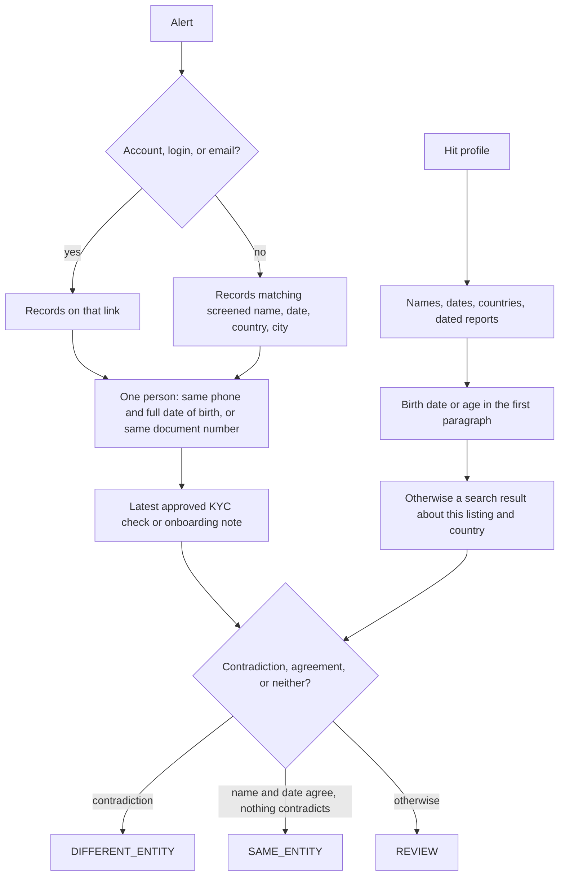

# Doppelgänger

Is this hit the customer, or just the same name?

## How the decision is made

`system/run <data folder> <output file>` reads that folder and writes one JSON line per hit. If you pass the Google Sheets workbook instead of a folder, it converts the workbook first (same result as `python3 system/convert_xlsx.py`). Nothing is random and no model is called, so five runs produce the same decisions and the same reason codes. A development run takes a few seconds and costs nothing.

The development workbook contains 440 alerts and 819 hits. That is the figure on its Start here tab. The brief's "about 440 alerts with 820 hits" is that same set, rounded. `output/dev.jsonl` has exactly one line for each of the 819 hits. On that file the engine clears 465 hits, confirms 122, and leaves 232 for review.



```
alert
  │
  ├─ account, login or email  →  the customer records on that link
  └─ no link                  →  records whose name, date of birth,
                                 country and city fit what was screened
                │
                ▼
        same person if they share a phone and a full date of birth,
        or the same document number on an approved identity check
                │
                ├─ latest approved check (KYC file, or an onboarding note)
                │     legal name, date of birth, document country
                └─ other notes: countries the customer says they lived in
                                  │
hit                               │
  ├─ names and aliases            │
  ├─ dates: the dob field, else "born on" or an age in the first paragraph,
  │         else a search result about this listing in a linked country
  ├─ countries on the profile
  └─ dated reports, and a date of death
                │
                ▼
   a real contradiction      →  DIFFERENT_ENTITY   (cleared)
   name and date agree,
   and nothing contradicts   →  SAME_ENTITY        (confirmed)
   otherwise                 →  REVIEW
```

A missing field is not a mismatch. A rejected or expired identity check is ignored. The verified legal name outranks the name on the customer record, which may be a nickname or a typo. Names ignore case, accents, punctuation and initials. Mohammed matches Muhammad, Abdulsalam matches Abdul Salam, and a part may be one or two letters off once it is long enough. Company words such as Ltd and GmbH are not name parts.

A hit is cleared only when something cannot be true of both sides: the customer was under 16 at the earliest dated report, the dates of birth contradict, the verified name matches none of the hit's names, every country differs, one side is a person and the other a company, or the profile says the person died before screening. One agreeing date of birth stops a date clearance. A country difference does not clear a hit whose name and date of birth already agree; that hit stays in review.

A person is confirmed when the name and the date of birth agree and nothing contradicts them. A company is confirmed when the name and a country agree. If more than one person fits the alert, each is decided; if they disagree, the hit is `REVIEW` / `AMBIGUOUS_CUSTOMER_RECORD` and the customer id is `AMBIGUOUS`.

The evidence list is only the records that decided the hit: the customer records, the identity check or note, and a search result when the date came from one. It is not everything the pipeline opened.

## Determinism, model, and cost

No model and no prompts. The rules are fixed code, so two runs write the same bytes. A development run takes about 4 seconds on this machine and costs nothing. An alert is cleared only when every hit is `DIFFERENT_ENTITY`. One `SAME_ENTITY` escalates the alert to compliance. Anything else still needs an analyst.

## Screen a new customer

`POST /api/screen` searches every watchlist profile with the same name rules, then judges each name match with the same decision engine. The body is JSON. A hit's dates and countries in the response come from the watchlist profile, its notes, or web search results, not from the customer you typed.

```bash
curl -s http://127.0.0.1:8766/api/screen \
  -H 'Content-Type: application/json' \
  -d '{"customer_name":"Sousa da Silva, Matheus","customer_type":"Individual","customer_dob":"1967","customer_countries":"Japan"}'
```

The same call from the command line, without the page:

```bash
python3 system/screen_one.py path/to/data --name "Sousa da Silva, Matheus" --dob 1967 --country Japan
```

On the development set that customer passes: the only name match is a different person. The page's other example buttons escalate Adnan Muhammad Amin Al-Rawi, born 17 January 1985, and leave Mohammed Bin Awadh Bin Abdul Rahman Al Hassan, with no date of birth, for an analyst.

The verdict is `PASS` (no name match, or every match is a different person), `ESCALATE` (any match is the same person), or `NEEDS_ANALYST`.

## The review page

`python3 system/serve.py <data folder> output/dev.jsonl` loads this same engine. Run decision, Test against answers and Try your own all call it, so a live result matches the saved file. Demo picks on the development set:

- Large date gap: alert `A-499A43`, hit `H-03F7A2` (born 2002 against a 1945 listing).
- Same person: alert `A-957E63`, hit `H-0181BD` (Marcos Costa, Brazil).
- Needs review: alert `A-438429`, hit `H-008282` (Faruk Umar, Nigeria, no date of birth to compare).

Alert `A-0059CE` is the ambiguous one: three Martin Austin Kaalund records, all contradicted, so the hit is cleared.

## Three cases

**Cleared.** Hit `H-8E4EC8`. The customer is linked only to the Netherlands and the hit only to the United States. Reason code `LOCATION_MISMATCH`.

**Same person.** Hit `H-582410`, customer `CUS-377745`. The date of birth on note `NOTE-14E25A` is 1968-03-05, which agrees with the hit's age (1967 or 1968). Both sides are linked to Spain, and the name agrees with Elvira Velasco Morillo. Reason code `NAME_DOB_LOCATION_MATCH`.

**Review.** Hit `H-FF3096`. The name agrees and note `NOTE-10AEAB` links the customer to the United States, which is also on the hit. The hit has no date of birth, so the hit can be neither cleared nor confirmed. Reason code `INSUFFICIENT_DATA`.
